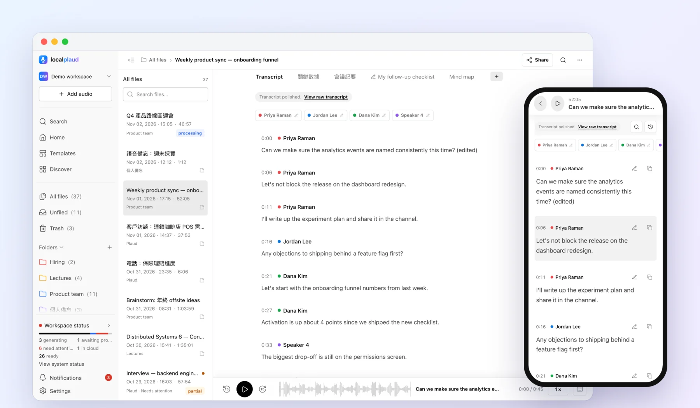
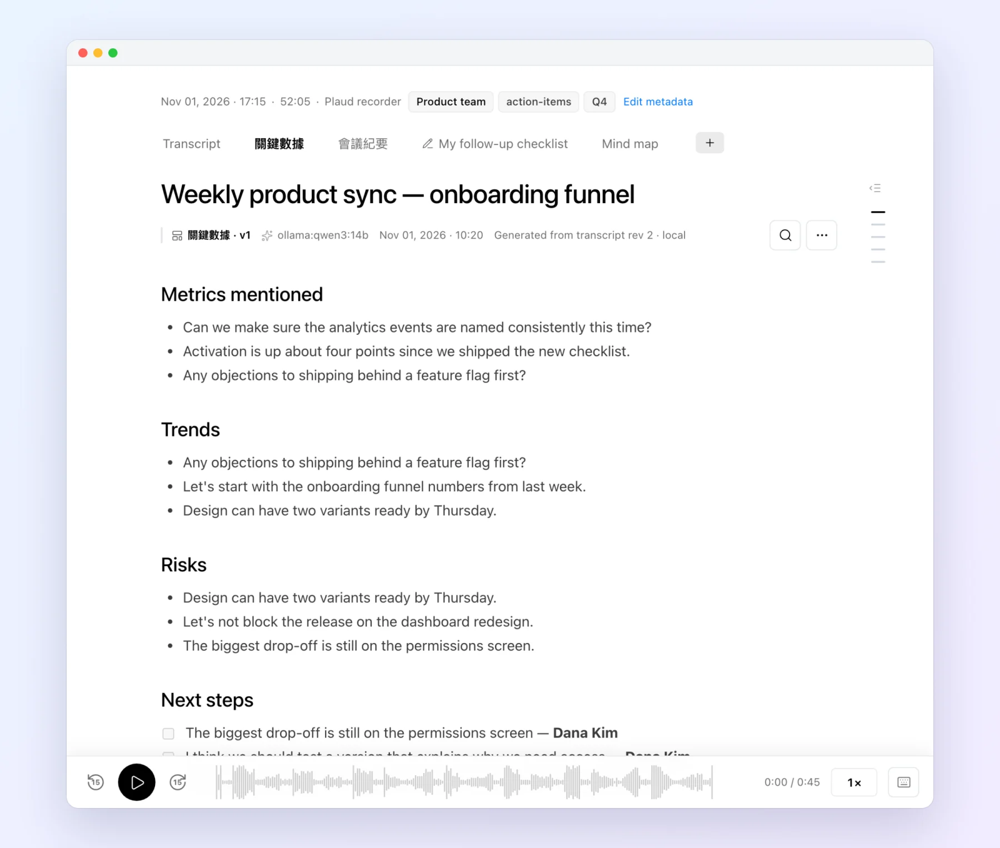
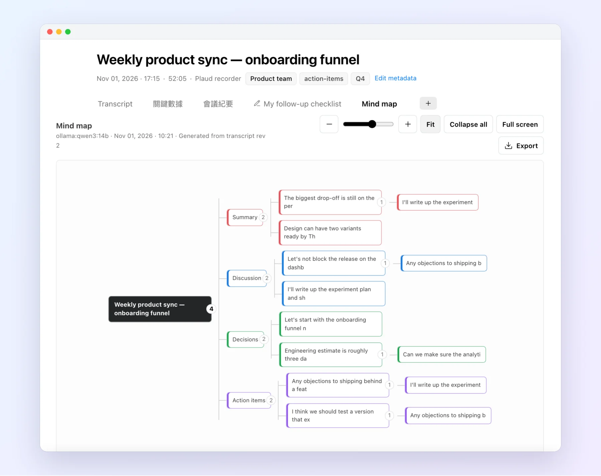
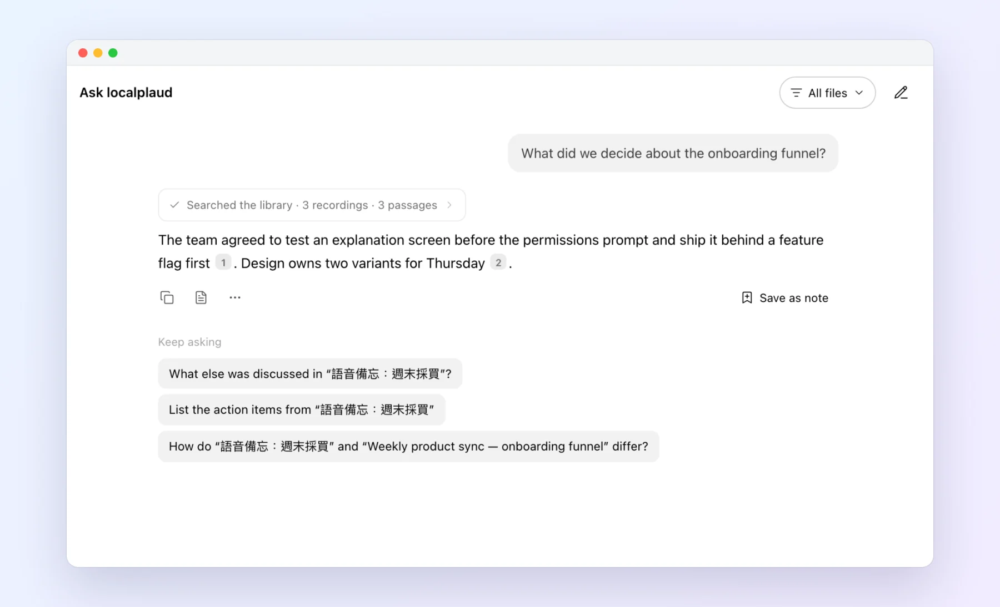
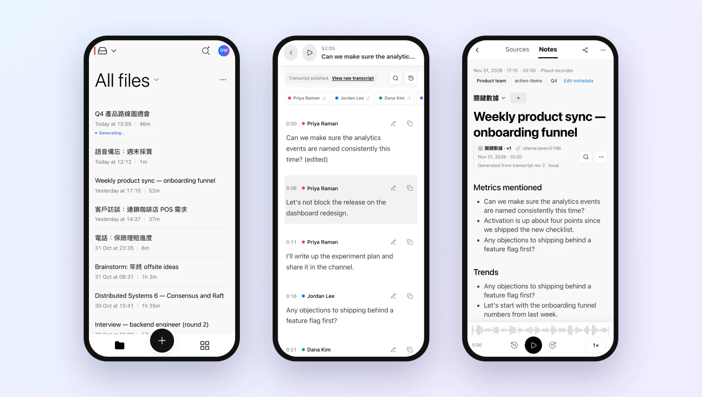
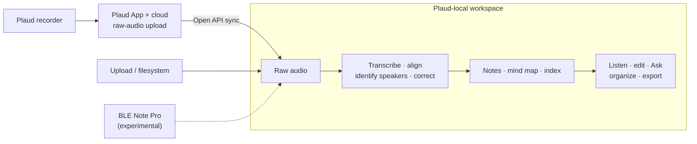

<p align="center">
  
</p>

<h1 align="center">Plaud-local</h1>

<p align="center">
  Self-hosted Plaud Note intelligence on
  <a href="https://github.com/skyhong2002/localplaud">localplaud</a>.<br>
  Product repository:
  <a href="https://github.com/vkotios/plaud-local-assistant"><code>vkotios/plaud-local-assistant</code></a>
</p>

<p align="center">
  <a href="https://github.com/vkotios/plaud-local-assistant/actions/workflows/ci.yml"></a>
  <a href="LICENSE"></a>
  <a href="pyproject.toml"></a>
  <a href="docs/platform-matrix.md"></a>
  <a href="docs/ble.md"></a>
</p>

<p align="center">
  <a href="#quickstart">Get started</a> ·
  <a href="docs/platform-matrix.md">Platforms</a> ·
  <a href="docs/UPSTREAM.md">Upstream</a> ·
  <a href="#documentation">Docs</a> ·
  <a href="CONTRIBUTING.md">Contribute</a>
</p>

## What this is

**Plaud-local** keeps the Plaud recorder + official App for capture and cloud
raw-audio upload, then runs transcription, diarization, notes, Ask, and export
on hardware you control—so you can stay on Plaud’s free plan and never press
Generate.

It is a **fork / product tree** of [localplaud](https://github.com/skyhong2002/localplaud)
(MIT), with packaging, ingest, inference, MCP, and experimental BLE overlays for
this repository. Upstream history is preserved; pin and rebase notes live in
[docs/UPSTREAM.md](docs/UPSTREAM.md). Attribution:
[NOTICE](NOTICE), [ATTRIBUTION.md](ATTRIBUTION.md).

You can also upload any audio file. Screenshots below show the upstream
localplaud Web App (synthetic demo library).

<p align="center">
  
</p>

## Upstream / fork

| | |
| --- | --- |
| **This repo** | https://github.com/vkotios/plaud-local-assistant |
| **Upstream** | https://github.com/skyhong2002/localplaud |
| **Pin / rebase** | [docs/UPSTREAM.md](docs/UPSTREAM.md) (ADR [0009](docs/adr/0009-fork-wrap-boundary.md)) |
| **Licence** | MIT (localplaud + Plaud-local overlays; OpenPlod BLE under MIT — see NOTICE) |

Prefer wrap/adapt overlays over rewriting shared localplaud modules. Contribute
generic fixes upstream when they belong there.

## Mods & additions vs upstream

Shipped on this `main` (see [CHANGELOG](CHANGELOG.md)):

- **Unified ingest + dedupe** — cloud Open API and filesystem import with
  library dedupe (link-by-default); BLE adapter present but experimental
  ([docs/ingest-dedupe.md](docs/ingest-dedupe.md), [docs/ble.md](docs/ble.md))
- **Official Plaud Open API only** for cloud sync — no private / reverse-engineered
  Plaud APIs ([docs/plaud-api.md](docs/plaud-api.md), NOTICE)
- **IGM-oriented gateway client** — OpenAI-compatible
  [inference-gateway-manager](https://github.com/vkotios/inference-gateway-manager)
  (`/v1`, concurrency **1**, HTTP 409 busy retry); cloud LLM opt-in
  ([docs/deploy-fedora-igm.md](docs/deploy-fedora-igm.md))
- **Read-only local knowledge MCP** — `plaud-local-knowledge-mcp`, distinct from
  `@plaud-ai/mcp` ([docs/mcp-knowledge.md](docs/mcp-knowledge.md), ADR [0010](docs/adr/0010-mcp-split.md))
- **Platform packaging** — Fedora/Docker core, Windows 11 WSL policy, BLE **host**
  docs; Compose `core` profile; BLE unsupported in default containers
  ([docs/platform-matrix.md](docs/platform-matrix.md),
  [deploy-fedora.md](docs/deploy-fedora.md),
  [windows.md](docs/windows.md),
  [ble-host.md](docs/ble-host.md))
- **Experimental BLE Note Pro adapter** — OpenPlod-derived (MIT attribution);
  Mac scan proven; Partner authorize / download **deferred**; **not GA**
  ([docs/ble.md](docs/ble.md), ADR [0011](docs/adr/0011-ble-experimental-policy.md))
- **Hardening** — sealed backup restore fix, [SECURITY.md](SECURITY.md) overlay,
  security / release checklists, ADRs 0009–0011
  ([docs/security-checklist.md](docs/security-checklist.md),
  [docs/performance.md](docs/performance.md))

### Supported vs experimental

| Path | Status |
| --- | --- |
| Cloud ingest via official Plaud Open API (`auth login` + poll/download) | **Supported** |
| Filesystem / Web App upload | **Supported** |
| BLE Note Pro transfer (OpenPlod-adapted adapter) | **Experimental / deferred** — not GA |
| Default Docker profiles for BLE radio | **Not supported** |

## Features (from localplaud)

### Transcripts with speakers you can name

Whisper large-v3-turbo plus pyannote diarization. Click any line to seek, rename
speakers once, fix text inline, and compare the corrected transcript with raw ASR.

### Notes from your own templates

Full-transcript coverage for long recordings, several note styles per recording,
and every note shows which model and transcript revision produced it.

<p align="center"></p>

### A mind map of every conversation

<p align="center"></p>

### Ask your whole library

Answers cite the recordings they came from; each citation jumps to the moment in the audio.

<p align="center"></p>

### Made for your phone, too

<p align="center"></p>

Plus folders, tags, full-text search, AutoFlow automation, and exports to TXT,
SRT, VTT, DOCX, PDF, and Markdown. Your edits are never overwritten, a failed
stage never discards good results, and you choose per stage whether AI runs
locally, on your own worker, or with a cloud provider.

<sub>Screenshots use the synthetic demo library from <code>scripts/seed_demo.py</code>.</sub>

## How it works



Speech runs on Whisper large-v3-turbo (MLX on Apple Silicon, faster-whisper on
CUDA/CPU) with pyannote speaker diarization. On this fork, text generation
defaults toward an IGM OpenAI-compatible gateway (concurrency 1); Ollama and
other providers remain available per stage.

## Quickstart

Requires **Python 3.11+**, **ffmpeg**, [uv](https://docs.astral.sh/uv/), and a
reachable LLM endpoint (IGM recommended on Fedora/AMD hosts; Ollama also works).

```bash
git clone https://github.com/vkotios/plaud-local-assistant.git
cd plaud-local-assistant

# Apple Silicon: use --extra mlx · NVIDIA: use --extra cuda
uv sync --extra faster-whisper --extra diarize --extra vad --extra local-llm

cp config.example.toml config.toml
cp .env.example .env
```

For speaker labels, accept the terms for
[`pyannote/speaker-diarization-community-1`](https://huggingface.co/pyannote/speaker-diarization-community-1)
and add `LOCALPLAUD_DIARIZE__HF_TOKEN=hf_...` to `.env`. On Apple Silicon, set
`asr.provider = "mlx-whisper"` in `config.toml`. Point LLM stages at IGM when
using [deploy-fedora-igm.md](docs/deploy-fedora-igm.md).

```bash
uv run localplaud init
uv run localplaud auth login   # one-time Plaud Open API OAuth (supported sync)
uv run localplaud doctor       # check auth, ffmpeg, and providers
uv run localplaud run          # sync + process + serve
```

Open **[localhost:8080](http://localhost:8080)**. The first sync catalogs your
library without downloading it; choose **Import audio** on any recording, and new
uploads download automatically.

Operators: [platform matrix](docs/platform-matrix.md),
[Fedora](docs/deploy-fedora.md), [Windows / WSL](docs/windows.md),
[upstream deploy guide](docs/deploy.md).

## FAQ

**Is everything local?** Plaud's App still uploads audio to Plaud's cloud. After
download, processing can be fully local; cloud providers are opt-in per stage.

**Can I use it without a Plaud recorder?** Yes—upload files with **Add audio**
([formats](docs/uploads.md)).

**Does BLE replace cloud sync?** No. Cloud Open API is the supported path. BLE
is experimental and Partner authorize/download is deferred ([docs/ble.md](docs/ble.md)).

**Is it safe to expose online?** It binds to `127.0.0.1` by default. Configure
[accounts](docs/accounts.md), a session secret, and HTTPS first. Plaud access is
read-only.

**Is it finished?** Active development. Core cloud + library workflow works end
to end; BLE is not GA.

## Documentation

| Topic | Read |
| --- | --- |
| Fork / upstream | [UPSTREAM.md](docs/UPSTREAM.md) · [NOTICE](NOTICE) · [ATTRIBUTION.md](ATTRIBUTION.md) · [ADRs](docs/adr/) |
| Install and operate | [Platform matrix](docs/platform-matrix.md) · [Fedora](docs/deploy-fedora.md) · [IGM](docs/deploy-fedora-igm.md) · [Windows](docs/windows.md) · [BLE host](docs/ble-host.md) · [Deployment](docs/deploy.md) · [Accounts](docs/accounts.md) · [Backups](docs/backups.md) |
| Ingest & BLE | [Ingest / dedupe](docs/ingest-dedupe.md) · [BLE](docs/ble.md) · [Plaud API](docs/plaud-api.md) |
| Speech and speakers | [Speech quality](docs/speech-quality.md) · [Remote workers](docs/remote-worker.md) · [Speaker identities](docs/cross-recording-speakers.md) |
| Notes | [Note quality](docs/note-quality.md) · [Chapter outlines](docs/chapter-outline.md) |
| Integrations | [Local knowledge MCP](docs/mcp-knowledge.md) · [Webhooks](docs/webhooks.md) · [Email delivery](docs/email-integrations.md) |
| Product and ops | [Changelog](CHANGELOG.md) · [Product workflow](docs/product-workflow.md) · [Security checklist](docs/security-checklist.md) · [Performance](docs/performance.md) |
| Troubleshooting | [Acceptance](docs/acceptance.md) · [Processing repair](docs/processing-repair.md) · [Support](docs/support.md) |

## Contributing

See the [contribution guide](CONTRIBUTING.md) and [Code of Conduct](CODE_OF_CONDUCT.md).
Questions about upstream localplaud go to its
[Discussions](https://github.com/skyhong2002/localplaud/discussions).
Vulnerabilities for this product tree: [SECURITY.md](SECURITY.md).

## License & attribution

[MIT](LICENSE). Based on **localplaud** © 2026 Sky Hong. Plaud-local overlays
© 2026 Vasileios Kotios and contributors. Experimental BLE modules adapted from
**OpenPlod** (MIT) — see [NOTICE](NOTICE) and [ATTRIBUTION.md](ATTRIBUTION.md).

Independent project; not affiliated with or endorsed by Plaud.
